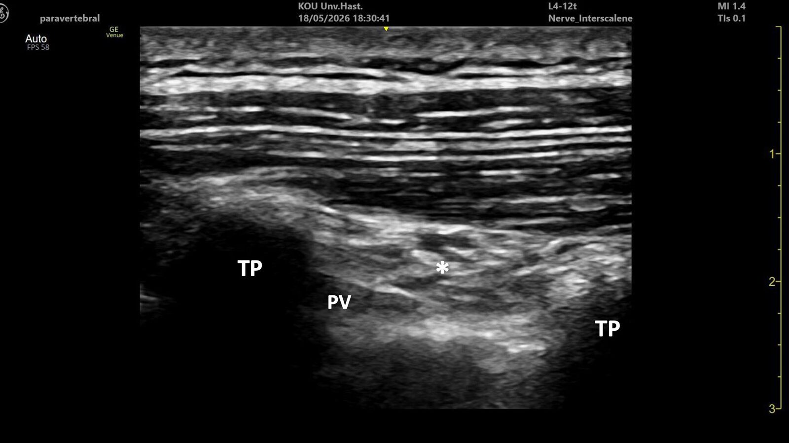

Ultrasonografi komplikasyonları azalttı ama sıfırlamadı: sinir hasarı, LAST, vasküler yaralanma ve plevra ya da periton hasarı hâlâ günlük pratiğin parçası [3–5]. Literatür bu majör komplikasyonlara odaklanıyor. Bu rehber ise riskin önemli bir bölümünü belirleyen, ama sıklıkla atlanan pratik ayrıntıları ele alıyor; ardından son dönemde popülerleşen bazı teknikleri güvenlik açısından sorguluyor.

> [!IPUCU]
> Kapsam bilinçli olarak dar. LAST tedavisi, resüsitasyon hazırlığı, doz ve konsantrasyon seçimi, hasta ve taraf doğrulaması, sterilite ve görüntü optimizasyonu burada yok. Bunlar daha az önemli olduğu için değil, başka kaynaklarda ayrıntılı anlatıldığı için.

## Neyin ters gidebileceğini bilin

Komplikasyonlar nadiren tek bir mekanizmadan doğar. Örneğin paranöral kılıf içine yüksek hacimli, yüksek konsantrasyonlu ve epinefrinli bir enjeksiyon mekanik, kimyasal ve iskemik hasarı aynı anda tetikler [8, 22].

| Mekanizma | Ne olur? |
|---|---|
| **Kimyasal toksisite** | LA yüksek konsantrasyonda ve zayıf perfüze dokuda nekroz ve nörotoksisite yapar; hızlı emilim ya da damar içi enjeksiyon LAST'a yol açar [4, 10–12]. |
| **Mekanik travma** | Sinire doğrudan iğne, intrafasiküler giriş, damar ya da organ yaralanması. Belirleyici olan iğne ucunun gerçek zamanlı görülüp görülmediğidir. Epinöriumu olmayan sinir kökleri daha savunmasızdır [13–15]. |
| **İnflamatuvar hasar** | Postoperatif inflamatuvar nöropati bloğa bağlı hasarı taklit edebilir; uygulayıcıyı haksız yere suçlamadan önce akılda tutun [16, 17]. |
| **Kompresyon** | Kapalı kompartmana yüksek hacim, hematom, pozisyon hatası [9, 18]. |
| **İstenmeyen yayılım** | Servikal bloklarda frenik sinir paralizisi, ses kısıklığı, total spinal; adduktor kanal ve PENG'de kuadriseps güçsüzlüğü [8, 19–21]. |
| **Adjuvan** | Epinefrinle iskemi; deksametazonla hiperglisemi; klonidin ve deksmedetomidinle sedasyon, hipotansiyon, bradikardi; opioidle solunum depresyonu [22, 23]. |
| **Ekipman ve hata** | İğne kırılması, yanlış ilaç ya da konsantrasyon, enjektörlerin karışması; mekanizması belirsiz nadir tablolar (örneğin blok sonrası tremor) [24]. |

Bildirilmiş komplikasyonların tamamı sayfanın sonundaki **Tablo 1**'de.

## 1. Ergonomiyi kurun

Kötü ergonomi titrek el, kaybolan iğne görüntüsü, yorgunluk ve gereksiz doku travması demektir. Kurulum zaman kaybı gibi görünür ama kötü bir kurulum işlemi çok daha fazla uzatır. Kanıt sınırlı; argüman mekanizmaya dayanıyor [25].

> [!YAPIN]
> - Ekranı, boynunuzu çevirmeden bakacağınız yere koyun.
> - İğne giriş yolunu ultrasonografi planıyla hizalayın.
> - Hangi elle gireceğinizi, iğnenin yönünü, hastanın ve cihazın yerini **iğneyi açmadan önce** planlayın.
> - Işığı ve gürültüyü kontrol edin.

## 2. İğne yolunu planlayın

> [!YAPIN]
> - İğneden önce tüm blok alanını ve çevresini tarayın; en güvenli giriş noktasını seçin.
> - Küçük damarları yakalamak için **renkli ya da power Doppler'ı rutin** kullanın.
> - Mümkün olduğunda **in-plane** gidin. In-plane zor ise (örneğin siyatiğe anterior yaklaşım) yavaş ilerleyin.

> [!YAPMAYIN]
> Görmediğiniz bir yapının orada olmadığını varsaymayın.

**Bloğa özgü örnekler**
- **Supraklaviküler:** Akciğere değil, pleksusun altındaki **birinci kota** yönelin [26].
- **İnterskalen:** Orta skalenden geçen **uzun torasik ve dorsal skapular sinirlere** dikkat [27].
- **Retroklaviküler (RAPTIR):** İğne klavikulanın altında görünmez. Nerede belireceğini önceden kestirin; **uç tekrar net görünene kadar ilerlemeyin** [28]. Supraskapular sinir bu yolda olabilir [29].

## 3. Sinir stimülatörünü doğru kullanın

Stimülatör özellikle asistanlar için ek bir güvenlik katmanıdır ve ultrasonografide zor görülen sinirlerde (obturator, akustik gölgede kalan sinirler) yardımcıdır [30, 31]. Ancak iki eşik sıklıkla karıştırılır:

| Motor yanıt (0,1 ms) | Anlamı | Ne yapmalı? |
|---|---|---|
| **≤ 0,2 mA** | İğne ucu büyük olasılıkla **sinir içinde** (yüksek özgüllük) [32] | Enjekte etmeyin; yanıt kaybolana kadar geri çekin. |
| **0,3–0,5 mA'da var, altında yok** | Uygun perinöral konum [30] | Enjeksiyon için aranan son nokta. |
| **Düşük akımda yanıt yok** | İntranöral yerleşimi **dışlamaz**: sinir içindeki iğnelerin yaklaşık dörtte birinde yanıt için > 0,5 mA gerekmiştir [32, 33] | Ultrasonografi görüntüsüne güvenin. |

> [!DIKKAT]
> Stimülatör alarm verir, güvence vermez. Diyabetik ve diğer nöropatilerde eşik yükselir; iğne sinir içindeyken bile yanıt alınamayabilir [34].

> [!YAPMAYIN]
> - Ultrasonografide net gördüğünüz siniri yanıt almak için "dürtmeyin". Popliteal siyatikte sinir görünüyorsa yanıt aramak yalnızca manipülasyonu ve riski artırır. Yanıt olmaması ve LA'nın sinir çevresinde sarmal yayılımı yeterlidir [35].
> - 1 mA'nın üzerinde akım verirken iğne ilerletmeyin; hasta için rahatsız edicidir.

## 4. Enjeksiyon basıncını izleyin

**Eşik:** Açılış basıncı **~15 psi**. Hayvan modelinde intranöral enjeksiyon + yüksek basınç fasiküler hasar yapmış; hastalarda > 15 psi iğne-sinir temasını güvenilir şekilde göstermiştir [36, 37]. Hat içi basınç ölçerler kullanılabilir [38].

**Düşük maliyetli yöntem: Sıkıştırılmış hava tekniği (CAIT)** [39]
1. 20 mL enjektöre 10 mL LA, üzerine 10 mL hava çekin.
2. Enjeksiyon sırasında hava sütununu izleyin.
3. Hava **5 mL'nin üzerinde** kalıyorsa (sıkışma < %50) basınç < 15 psi, devam edin.
4. Hava **5 mL'nin altına** iniyorsa (sıkışma > %50) **durun.**

> [!DIKKAT]
> CAIT uçtaki değil **enjektördeki** basıncı gösterir. Uzun ya da esnek uzatma hortumu, ince iğne ve hızlı enjeksiyon sinyali sönümler ve geciktirir. Hava sütunu dirençteki değişikliğe gecikmeyle yanıt verir.

> [!YAPMAYIN]
> - Enjektörü hava altta kalacak şekilde tutmayın; önce LA yerine hava gider.
> - Kalan havayı asla enjekte etmeyin. LA hub'ı ve hortumu doldururken durun, kalan havayı enjektörle birlikte atın.

## 5. Aspirasyonu ve enjektörü doğru seçin

**Hidrodiseksiyon:** Hedefe ulaşınca az miktar serum fizyolojikle iğne ucunun yerini doğrulayın. Bu, hassas yapıları da iğneden uzaklaştırır.

**Neden negatif aspirasyon yanıltır?** Negatif basınç, enjektör hacmine değil **pistonun ne kadar çekildiğine** bağlıdır [40, 41]. Uç küçük bir damara kısmen girmişse sert aspirasyon damarı kapatır, kan gelmez; ardından enjeksiyon dozun bir kısmını damara verirken ekranda normal yayılım görülür (Şekil 1).

Enjeksiyon ilerledikçe pistonun arkasında boş hazne büyür; aynı "sert çekme" başlangıçtakinin katlarca hacmini boşaltır. Yani **aspirasyon blok ilerledikçe kendiliğinden sertleşir.**

> [!YAPIN]
> - Her dozdan önce **aynı küçük hareketi** yapın: yaklaşık **0,5 mL** çekin.
> - Aspirasyonu **yavaş ve acelesiz** yapın; kanın iğneyi ve hortumu geçmesine zaman tanıyın. Kanülde kanın görünmesi bile ~0,5 saniye sürer; blok iğnesi ve hortumda daha uzundur [42].
> - **Enjektörü doza göre seçin:** Çocukta 10 mL verilecekse 10 mL'lik enjektör; 20 mL verilecekse iki 10'luk değil, tek 20'lik enjektör.

> [!YAPMAYIN]
> Aşırı vakumdan kaçmak için küçük enjektöre geçmeyin. Küçük enjektör enjeksiyonu kolaylaştırır ve **yüksek açılış basıncını maskeler** [41].

**Yardımcıya her bloktan önce aynı sözlerle verilecek talimat**
1. Pistonu yalnızca **yarım mililitre** geri çek, fazlasını değil.
2. **İki saniye** tut.
3. Bu sırada ekrana değil, **hub'a ve hortuma** bak.
4. Enjeksiyona devam etmeden önce pistonu **tamamen bırak.**
5. **5 mL'lik** dozlar hâlinde ver, aralarda tekrar aspire et.
6. Yalnızca kan geldiğinde değil, **dirençte ya da hortumda herhangi bir değişiklik olduğunda** sesli söyle.

> [!IPUCU]
> Son maddeyi "kan gelirse söyle" yerine "bir şey değişirse söyle" diye vermek, deneyimimizde farkı yaratan noktadır. Bu, damarların ve iğnelerin daha küçük olduğu çocuklarda daha da önemlidir.

## Yeniden düşünülmesi gereken teknikler

Her yeni teknik zorunlu olarak güvenli değil. Posterior interskalen yaklaşım total spinal gibi komplikasyonlar nedeniyle terk edildi; derin servikal pleksus bloğundan artık genellikle kaçınılıyor [44, 45]. Aşağıdaki teknikler etkili olabilir, ama güvenlik soruları yanıtsız.

### Transvers çıkıntı-plevra orta nokta (MTP) bloğu

**Lehine:** Son noktası paravertebral alandan daha kolay bulunur, plevraya girmediği için ponksiyon riski muhtemelen düşüktür [46]. VATS'ta torakal paravertebral blokla eşdeğer analjezi sağlamış [47].

**Kaygımız:** Bu noktada iğne ucu paravertebral alanda ya da erektör spina kasında değil; levator kostarum, intertransversarii kasları ve superior kostotransvers ligaman arasındaki **intertransvers doku kompleksindedir** (Şekil 2). 20 mL ya da daha fazlası yağlı bir boşluğa değil, kas ve yoğun bağ dokusuna verilir. LA'lar deneysel olarak miyotoksiktir [12, 48–50]. Enjeksiyon yeri ağrısını raporlayan bir MTP çalışması bulamadık.

> [!IPUCU]
> MTP'yi rutin varsayılan blok yapmadan önce ESP ya da retrolaminar bloğu düşünün. MTP çalışması yapıyorsanız enjeksiyon yeri ağrısını da kaydedin.

### Servikal erektör spina plan bloğu

**Lehine:** Omuz cerrahisinde interskalene alternatif olarak tanımlandı; C6–C7 transvers çıkıntılarının posterioruna verilen 20 mL boya pleksus köklerini tutarlı biçimde boyadı [53].

**Kaygımız:** Aynı kadavra çalışmasında anterior skalen %40, **frenik sinir 3 enjeksiyonda** boyandı [53]. Posterior servikal planlar lateralde kapalı değil; frenik sinir, pleksus kökleri ve sempatik zincirin bulunduğu prevertebral kompartmanla iletişim hâlinde [54]. İnterskalen olukta 5 mL, 20 mL ile eşdeğer analjezi sağlarken [55], bu kompartmana 20 mL vermek interskalen bloğun komplikasyonlarını (ses kısıklığı, hemidiyafragmatik parezi, Horner, total spinal) tekrarlayabilir [56]. Derin servikal pleksus bloğunun enjeksiyon noktası da aynı bölgededir.

> [!DIKKAT]
> ESP'nin bittiği tek bir vertebra düzeyi yok. Ancak üst torakal düzeylerin üzerinde yayılımın hem genişliği hem varış yeri öngörülemez hâle gelir. Bu bizim tercihimiz: servikal ESP'den kaçınıyoruz.

### İntramüsküler kuadratus lumborum bloğu

**Lehine:** Sezaryen sonrası etkili analjezi bildirildi [58]; etkinliği tartışmıyoruz.

**Kaygımız:** Kas içine verilen bupivakain ve ropivakain doza bağlı miyosit nekrozu, tekrarlı maruziyette fibrozis yapar [12, 48–50]. Hiçbir çalışma enjeksiyon yeri ağrısını, kas hassasiyetini ya da kasın görüntülenmesini sonuç ölçütü almadı; izlem süreleri kısa.

### Popliteal siyatikte Vloka fasyası içine (subparanöral) enjeksiyon

**Lehine:** İki randomize çalışmada perinöral enjeksiyondan daha hızlı başlangıç; kalıcı nörolojik defisit bildirilmedi [62, 63].

**Kaygımız:** Bu çalışmalar küçük ve sinir hasarını saptayacak güçte değil. Sıkı sınırlı bir kompartmana 20 mL vermek sinirleri ve vasa nervorumu sıkıştırır (Şekil 3). Kılıf içinde posteriorda küçük ayrı fasiküller de vardır ve posterior yaklaşan iğne için risk altındadır [61, 62].

> [!IPUCU]
> Kendi pratiğimizde bu yaklaşımı bıraktık: az sayıda hastada motor blok beklenenin çok ötesinde, bazen 2. postoperatif güne kadar sürdü. Bu bir gözlem, veri seti değil. İğneyi sinire yöneltmeyin, kılıfın bütünlüğünü bozmayın.

### Supin anterior kuadratus lumborum bloğu

Bilateral blokta pozisyon değiştirmemek için tanımlandı [64]. Ancak medial trajektuvar iğneyi **periton, böbrek ve büyük damarlara** yaklaştırır. Her hasta için uygun değildir; makul bir alternatif varken sorunlu bir teknikte ısrar etmek nadiren daha güvenlidir.

## Bloktan önce kontrol listesi

**Hazırlık**

- [ ] Ekran, hasta ve ben aynı hatta; boynumu çevirmeden ekranı görüyorum
- [ ] Giriş noktası ve iğne yolu planlandı, alan Doppler ile tarandı
- [ ] Enjektör planlanan hacme uygun boyutta
- [ ] Yardımcıya aspirasyon talimatı verildi

**İşlem sırasında**

- [ ] İğne ucunu her an görüyorum (mümkünse in-plane)
- [ ] Hidrodiseksiyonla uç doğrulandı
- [ ] Stimülatörde ≤ 0,2 mA yanıt yok
- [ ] Açılış basıncı < 15 psi (CAIT'te hava ≥ 5 mL)
- [ ] Her 5 mL'den önce 0,5 mL'lik, acelesiz aspirasyon yapıldı
- [ ] LA yayılımı fasyal planda / sinir çevresinde görülüyor

**Karar**

- [ ] Bu blok bu hasta için gerçekten gerekli mi?
- [ ] Daha basit ve tekrarlanabilir bir alternatif var mı?

> [!IPUCU]
> En güvenli blok, klinik hedefe ulaşan en basit ve en tekrarlanabilir tekniktir. Her blokta aynı soruyu sorun: Kim için, hangi yarar için ve hangi riskle?

## Tablo 1. Bildirilen komplikasyonlar

Komplikasyonlar olası altta yatan mekanizmaya göre gruplanmıştır. Birçok komplikasyon birden fazla mekanizmayla ortaya çıkabildiğinden birden fazla başlık altında yer almaktadır [6–8, 12–14, 21, 24, 48–50, 56, 59–62, 65–100]. Diş ve diğer baş-boyun blokları bilinçli olarak tabloya dahil edilmiştir; çünkü baş ve boyun bölgesi, bir enjektatın ne kadar uzağa gidebileceğini ve komşu yapıların ne kadar savunmasız olduğunu özellikle açık biçimde göstermektedir.

| Mekanizma | Literatürde bildirilen komplikasyonlar |
|---|---|
| **Kimyasal toksisite** | **Afazi** [81] · **Ataksi** [4, 88] · Kondrotoksisite [12] · **LAST** [3, 4, 98] · Metemoglobinemi [98] · **Miyoklonus** [79] · **Miyonekroz** [12, 48, 49, 50] · **Motor blok** [11, 97] · **Parapleji** [9, 90] · **Parestezi** [4, 7, 9] · **Parezi** [7, 9, 90] · **Sinir hasarı** [10, 11, 13, 14] · **Transvers miyelit** [90] · **Uzamış blok** [11, 78] · **Vertigo** [4, 88] · **Yumuşak doku nekrozu** [10, 12] · Öfori [80] · **Ölüm** [6, 67, 96] |
| **Mekanik travma** | **Diplopi** [87, 95] · **Dispne** [28, 66, 68] · **Fasiyal sinir felci** [85] · Hematom [6, 9, 67] · **Hemiparezi** [81] · **Hipoglossal sinir felci** [89] · **İntraperitoneal enjeksiyon** [93] · **Kronik ağrı** [7, 9, 13] · Organ hasarı [6, 15, 64, 93] · **Parapleji** [44] · **Parestezi** [4, 7, 15, 69] · **Parezi** [4, 7, 15] · Pnömotoraks [26, 66, 68] · Psödoanevrizma [74] · **Sinir hasarı** [7, 13, 14, 15, 65, 69] · **Uyuşukluk** [4, 7, 78] · **Uzamış blok** [59, 60, 61, 62, 78] · Vasküler ponksiyon [6, 26, 40] · **X–XII. kraniyal sinir felci** [83] · **Ölüm** [6, 15, 67] |
| **İnflamatuvar hasar** | **Kronik ağrı** [16, 17] · **Sinir hasarı** [16, 17] · **Transvers miyelit** [16, 17] |
| **Kompresyon** | **Fasiyal sinir felci** [85] · **Hipoglossal sinir felci** [89] · Kompartman sendromu [9, 18] · **Parapleji** [9] · **Parezi** [9, 18] · **Sinir hasarı** [9, 13, 18, 60] · **Uzamış blok** [60, 61] |
| **İstenmeyen yayılım** | **Afazi** [81] · **Ataksi** [88] · Beyin sapı anestezisi [72] · Bilateral blok [51] · **Bradikardi** [94] · **Bulantı, kusma** [96] · **Diplopi** [87, 95] · **Dispne** [8, 56] · **Fasiyal sinir felci** [85] · Harlequin sendromu [71] · Hemidiyafragmatik paralizi [56] · **Hemiparezi** [81] · **Hipoglossal sinir felci** [89] · **Hipotansiyon** [94, 97] · Horner sendromu [56, 67] · **İdrar retansiyonu** [84] · **Kalıcı hıçkırık** [77] · **LAST** [3, 4] · Monoplatitelya [91] · **Motor blok** [20, 21, 97] · **Parapleji** [44] · Priapizm [76] · **Senkop** [94] · Ses kısıklığı (rekürren laringeal sinir) [8] · Total spinal anestezi [19, 44, 45] · **Transvers miyelit** [90] · **Uyuşukluk** [7] · **Vertigo** [88] · **X–XII. kraniyal sinir felci** [83] · **Ölüm** [19, 44] |
| **Adjuvanla ilişkili etkiler** | **Bradikardi** [23] · **Bronkospazm** [23] · **Bulantı, kusma** [23] · Hiperglisemi [23] · **Hipotansiyon** [23] · **İdrar retansiyonu** [23] · Kabızlık [23] · **Kronik ishal** [92] · **Miyonekroz** [22, 48, 49, 50] · **Yumuşak doku nekrozu** [22] |
| **Diğerleri ve ekipmanla ilişkili** | Alerjik reaksiyon [67, 96] · Başarısız blok [86] · **Bradikardi** [94] · **Bronkospazm** [96] · **Bulantı, kusma** [96] · Enfeksiyon [9, 75] · Geçici hipertansiyon [82] · **İntraperitoneal enjeksiyon** [93] · İğne kırılması [70] · **Kalıcı hıçkırık** [77] · Kateter kopması / geride kalan parça [99] · **Kronik ağrı** [7, 73] · **Kronik ishal** [92] · **Miyoklonus** [79] · **Motor blok** [97] · Nekrotizan fasiit [75] · Psoas apsesi [100] · **Senkop** [94] · Tremor [24] · **Ölüm** [75] |

*Kalın yazılan komplikasyonlar birden fazla altta yatan mekanizmayla ilişkilidir. LAST: lokal anestezik sistemik toksisitesi. Tablo bildirilmiş komplikasyonları listeler ve bilinçli olarak sıklıkları ya da ciddiyetleri hakkında bilgi vermez: Kondrotoksisite, öfori ve monoplatitelya gibi girdiler tek olgu sunumlarına dayanırken, diğerleri rutin pratikte karşılaşılacak kadar sıktır. Tablo göreceli riskin bir rehberi olarak değil, tanımlanmış olanların bir haritası olarak okunmalıdır.*
