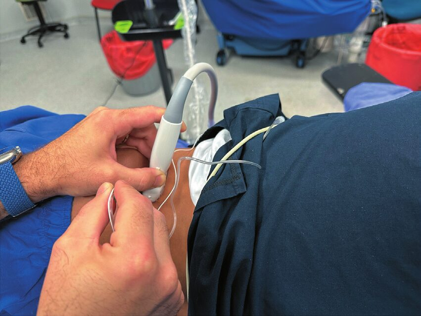
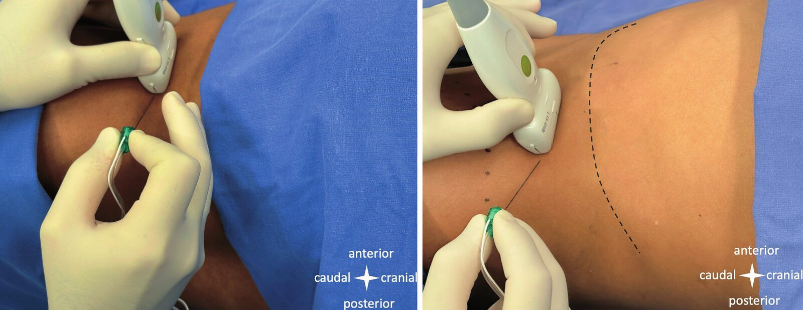
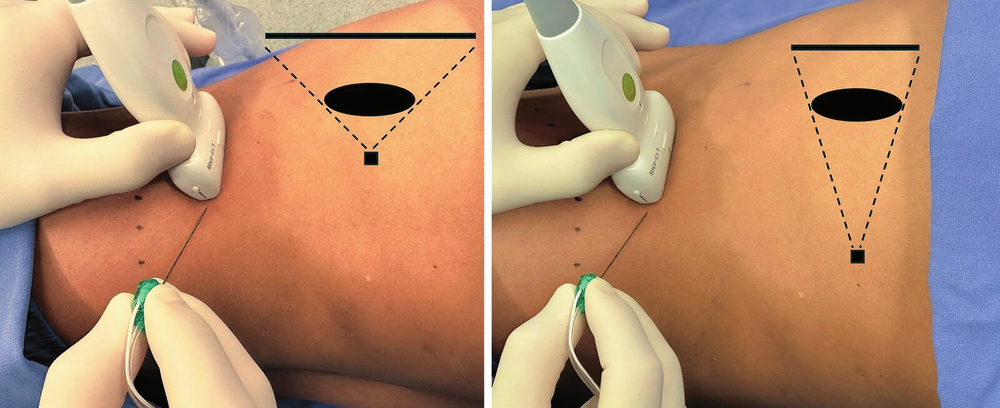
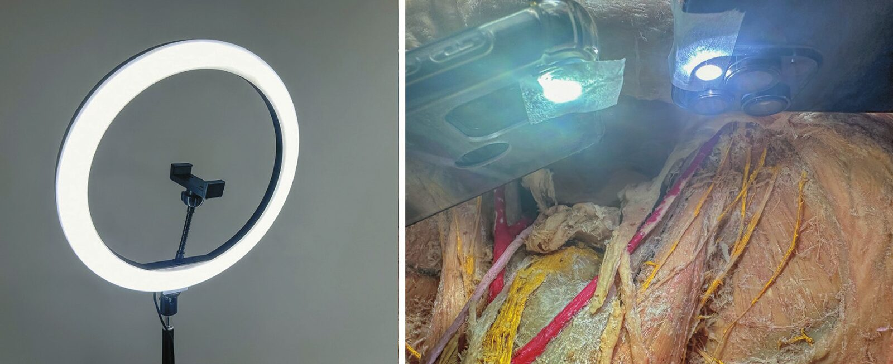
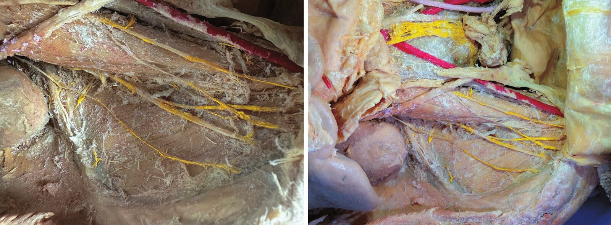

Yeni bloklar neredeyse her gün tanımlanıyor; bir tekniği doğru anlatmanın ya da doğru anlamanın en kısa yolu iyi bir görüntü. Ancak saygın dergilerde bile yanıltıcı ultrasonografi görüntüleri, karmaşık hasta fotoğrafları ve yetersiz aydınlatılmış kadavra görselleri yayımlanabiliyor. Bu rehber; makale, kitap bölümü, sunum ya da sosyal medya için görüntü hazırlarken izlenecek adımları özetliyor. En sonda gönderimden önce kullanabileceğiniz bir kontrol listesi var.

## Adım 1. Doğru probu seçin

- **4 cm'ye kadar** derinlikteki yapılar: lineer prob
- **5 cm'den derin** yapılar: konveks prob
- **4–5 cm arası:** hangisi daha iyi görüntü veriyorsa onu kullanın

> [!YAPMAYIN]
> 3 cm derinlikteki siyatik siniri konveks probla göstermeyin. Konveks prob kullanıyorsanız görüş açısını ne çok dar ne çok geniş tutun ve yapıyı ortaya alın.

## Adım 2. Cihazı ayarlayın

1. **Derinlik:** Hedef yapı görüntünün ortasında kalsın; frekansı buna göre seçin.
2. **Odak:** Hedef yapının derinliğine getirin. Odak diğer derinliklerin kalitesini düşürür.
3. **Kazanç (gain):** Görüntü ne karanlık ne grenli olsun. Derinliğe göre eşitlemek için TGC düğmelerini kullanın.
4. **Doppler:** Damarları kollabe edecek kadar bastırmayın. Doppler açıkken görüntü kalitesi düşer; Doppler kapalıyken ayrıca bir görüntü daha alın.

## Adım 3. Ultrasonografi görüntüsünü kaydedin

> [!YAPIN]
> - Görüntüyü yapılar konusunda **hiç şüphe kalmadığında** kaydedin.
> - İlacın yayılımını gösterecekseniz **enjeksiyon öncesi ve sonrası** iki görüntü alın.
> - Görüntüyü **cihaza kaydedip dosya olarak dışa aktarın.**
> - Ön ayar adlarını ve gereksiz boşlukları kırpın, ama **derinlik ölçeğini bırakın.**
> - **Lateral-medial / kraniyal-kaudal** yönlerini belirtin.
> - Anatomik etiketleri **renksiz**, makalenin yazı tipinde ve okunur boyutta yazın.
> - **İğnenin ilerleme yönünü ve enjeksiyon noktasını** gösterin.

> [!YAPMAYIN]
> - Cihaz ekranının fotoğrafını çekmeyin.
> - Ultrasonografi görüntüsü üzerinde parlaklık, kontrast ya da içerik düzenlemesi yapmayın. Okuyucu kendi cihazında elde edemeyeceği bir görüntüyle yanıltılmamalı.
> - Yalnızca enjeksiyon sonrası görüntüyle yetinmeyin. Enjeksiyondan sonra kas sınırları bozulabilir, hava kabarcıkları görüntüyü kirletebilir.

## Adım 4. Hasta-model fotoğrafını çekin

Prob ve iğne pozisyonunu gösteren fotoğraf kolay görünür ama ekip işidir. Amaç, istenen bölgeyi ve prob-iğne yönelimini dikkat dağıtmadan göstermektir.

**Pozisyon:** Hastaya gösterim için değil, bloğu gerçekte yaptığınız gibi pozisyon verin (destek araçları dahil). Birden çok pozisyon mümkünse daha kolay olanı seçin.

> [!YAPIN]
> - Kadraj dışını **leke ve kırışıklık olmayan, dikkat çekmeyen renkte** bir örtüyle kapatın.
> - Landmark'ları **cilt kalemiyle** işaretleyin (örneğin iliak krest).
> - Prob ve iğneyi tutan kişi **eldiven** giysin.
> - **Uzaklaşıp 3x optik zumla** çekin. Perspektif gözün gördüğüne yaklaşır, arka plan bulanıklaşır.
> - Gerekirse bilgisayarda örtü renginin **doygunluğunu azaltın** ya da kenarları bulanıklaştırın.

> [!YAPMAYIN]
> - Kablo, infüzyon hattı, laringoskop, enjektör, tıbbi atık, hatta fotoğrafçının ayağı kadrajda olmasın.
> - Saat, yüzük, üzerinde yazı olan kıyafet görünmesin.
> - Flaş kullanmayın, tavan lambasını kapatın, ışık doğrudan alana düşmesin.
> - Yakından geniş açıyla çekmeyin. Perspektif bozulur, gölge oluşur.
> - Dijital zum kullanmayın.

## Adım 5. Kadavra fotoğrafını çekin

Küçük sinirleri ve ilaç yayılımını göstermek için harici ışık şarttır; ama tek noktadan gelen ışık parlama ve gölge yaratır.

- **En iyisi:** Anatomi laboratuvarındaki profesyonel kamera ve **halka flaş**. Diyaframı daraltın (örneğin f/8); net alan genişler.
- **İmkân yoksa:** Fotoğrafı çeken telefonun flaşı yerine **iki yandan düşük ayarda** ışık tutun ya da birkaç telefonun flaşını **mat bant veya ince mat kâğıtla** kaplayıp farklı açılardan kullanın.

## Adım 6. Dosyayı saklayın

> [!YAPIN]
> - Cihazın izin verdiği **en yüksek çözünürlükte** çekin; mümkünse RAW formatında.
> - Dosyaları **doğrudan aktarın** (kablo, bulut, AirDrop).
> - Düzenlenmiş hâli **ayrı dosya** olarak en yüksek kalitede kaydedin; **ham görüntüyü silmeyin.**
> - Dosya adına **tarih ve içerik** yazın (örneğin 2026-03-14_ESP_T5_sag_enjeksiyon-oncesi).

> [!YAPMAYIN]
> Görüntüleri mesajlaşma uygulamalarıyla aktarmayın. Bu uygulamalar dosyayı sıkıştırır ve ayrıntılar kaybolur.

## Adım 7. Yönelimi eşleştirin

- Fotoğraftaki ve ultrasonografi görüntüsündeki **lateral-medial ve kraniyal-kaudal yönler aynı** olsun; oklarla gösterin.
- Yazıdaki **tüm görseller aynı yönelimde** ve modelin **aynı tarafından** (hepsi sağ ya da hepsi sol) çekilsin.

> [!IPUCU]
> Sağ alt ekstremitede obturator bloğundan sonra sol alt ekstremitede adduktor kanal bloğunu göstermek okuyucuyu zorlar. Bu basit ayrıntı en saygın dergilerde bile atlanıyor.

## Adım 8. İllüstrasyon ve etik

**İllüstrasyon:** Profesyonel bir illüstratörle çalışıyorsanız ne istediğinizi net anlatın ve çizimi birkaç kez kontrol edin. Metinle ve önceki literatürle çelişmediğinden emin olun. Kendiniz çiziyorsanız "bu kadarı yeter" demeyin; hatalar ve belirsiz yapılar gözden kaçar.

**Etik:**
- Yüz, dövme, yara izi gibi kimliği belli eden ayrıntılar görünmesin. Görünmesi zorunluysa hastaya fotoğrafın nerede ve ne amaçla kullanılacağını anlatıp **yazılı onam** alın.
- Renk ayarı ya da başka görüntüden öğe ekleme gibi belirgin bir düzenleme yaptıysanız ham hâlini **ek dosya** olarak sunun.
- Görüntü konuyu yeterince anlatmıyorsa, özellikle kadavra çalışmalarında, **video** ekleyin [14].

## Gönderimden önce kontrol listesi

**Ultrasonografi görüntüsü**

- [ ] Uygun prob seçildi
- [ ] Yapılar doğru tanımlandı
- [ ] Hedef yapı net ve görüntünün ortasında
- [ ] Yayılım gösterilecekse enjeksiyon öncesi görüntü de var
- [ ] Görüntü cihazdan dışa aktarıldı, ekran fotoğrafı değil
- [ ] Gereksiz yazı, işaret ve boşluklar kırpıldı
- [ ] Derinlik ölçeği görünüyor
- [ ] Yön işareti var
- [ ] Anatomik noktalar açıkça işaretli

**Hasta-model fotoğrafı**

- [ ] Kimlik gizlendi (yüz, dövme, yara izi)
- [ ] Arka plan sade, dikkat dağıtıcı nesne yok
- [ ] Aydınlatma yeterli, gölge ve parlama yok
- [ ] Landmark'lar net
- [ ] Yön işareti var

**Tüm görseller**

- [ ] Hepsi aynı yönelimde ve aynı taraftan
- [ ] Yazılar okunur ve anlaşılır
