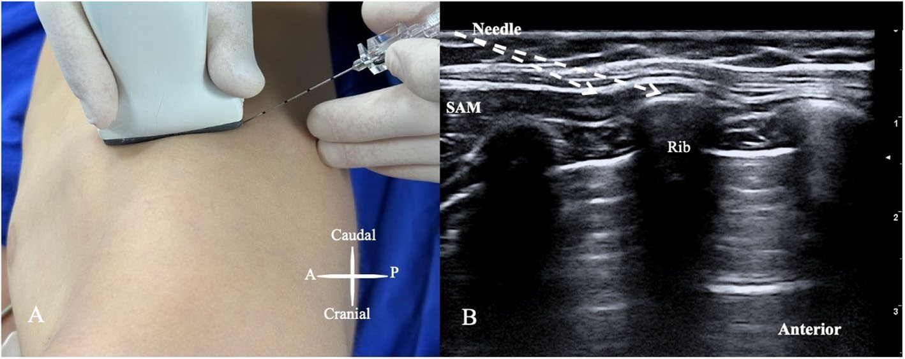
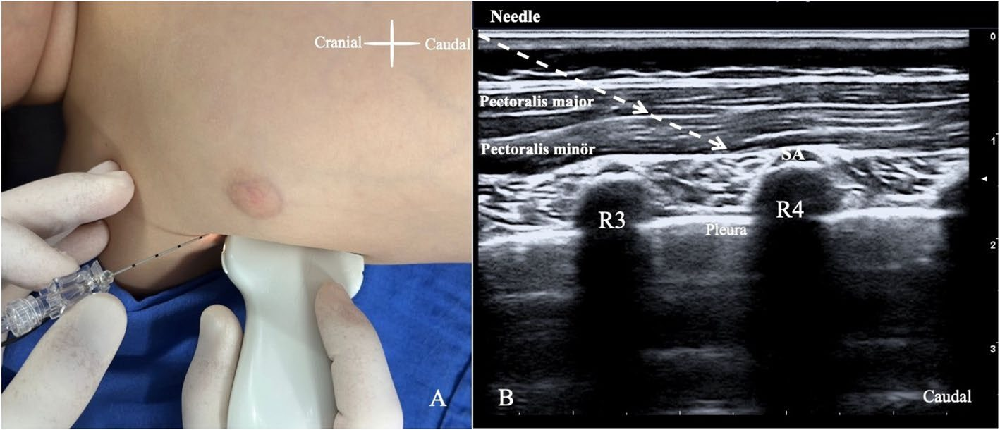
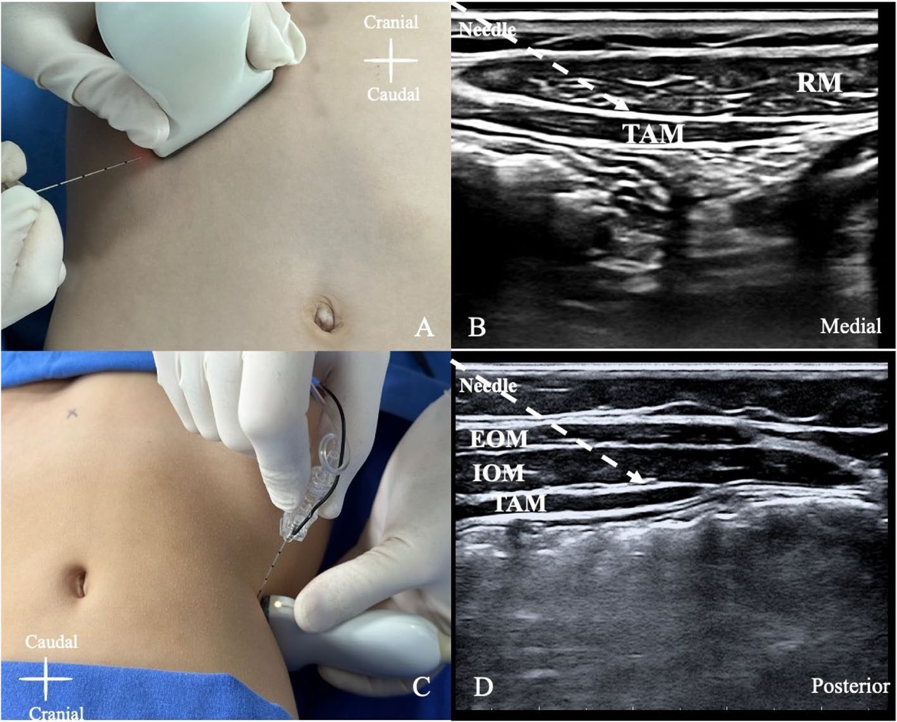
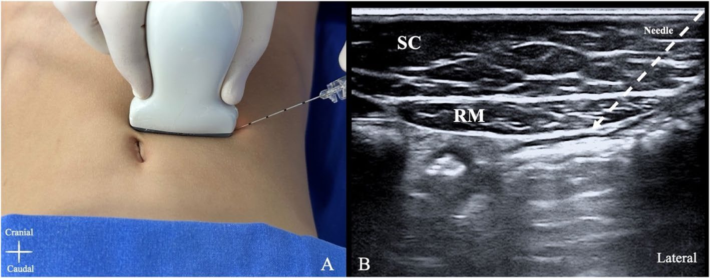
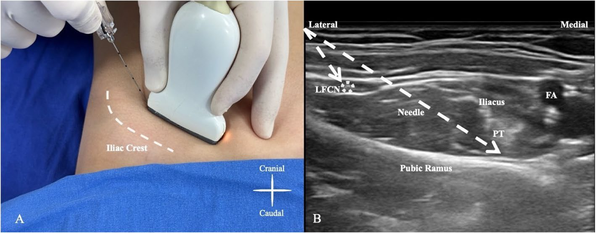

Cerrahi geçiren çocukların yaklaşık %80'i postoperatif ağrı yaşıyor ve bunların çoğunda ağrı orta-şiddetli [1, 2]. Fasyal plan blokları (FPB) öğrenmesi kolay, görece güvenli ve opioid koruyucu oldukları için çocuklarda giderek daha çok kullanılıyor. Klinik deneyimimiz, çocuklarda gevşek bağ dokusu sayesinde bu blokların erişkinlerden de etkili olduğu yönünde [15]. Bu rehberde kliniğimizde en sık kullandığımız bloklar, dozlarımız ve ipuçlarımız yer alıyor.

## Önce genel kurallar

> [!DIKKAT]
> - Toplam lokal anestezik hacmini **0,3–0,5 mL/kg ile sınırlayın**; düşük konsantrasyonu tercih edin.
> - Çocuklarda bağ dokusu gevşek, fasya daha geçirgen; sistemik emilim erişkinden fazla olabilir. Bir infantta ESP bloğu sonrası LAST bildirilmiştir [71].
> - Pik plazma düzeyi geç oluşabilir; hastayı **uzun süre monitörize edin** [70].
> - Her blokta **ilacın fasyal planda yayıldığını görün.** Yayılım görmüyorsanız kas içinde ya da damar içindesiniz.

FPB'lerin etki mekanizması tam aydınlatılmadı: LA plan içinde yayılır, fasya gözeneklerinden komşu dokulara geçer ve bir kısmı sistemik emilir [14]. Bu yüzden aynı bloğun her çocukta aynı etkiyi göstermesi beklenmemeli.

## Dozlarımız bir bakışta

Tüm bloklarda **%0,25 bupivakain ya da %0,2 ropivakain** kullanıyoruz.

| Blok | Hacim | En fazla | İğne |
|---|---|---|---|
| Serratus anterior plan | 0,3–0,5 mL/kg | 20 mL | 50 mm |
| İnterpektoral plan (PECS I) | 0,2–0,3 mL/kg | 20 mL | 50 mm |
| Pektoserratus plan (PECS II) | 0,5 mL/kg | toplam 30 mL | 50 mm |
| Erektör spina plan | 0,5 mL/kg | 20 mL | 50 mm |
| Transversus abdominis plan | 0,3–0,5 mL/kg | 20 mL | 50 mm |
| Kuadratus lumborum | 0,5 mL/kg | 20 mL | 50–80 mm |
| Rektus kılıf | 0,2–0,3 mL/kg | – | 50 mm |
| PENG | 0,3–0,5 mL/kg | 20 mL | 50–80 mm |

## Serratus anterior plan bloğu

**Hedef:** T2–9 interkostal sinirlerin lateral kutanöz dalları, interkostobrakiyal, uzun torasik ve torakodorsal sinirler [18].

**Endikasyon:** Torakotomi, göğüs tüpü, pektus ekskavatum onarımı, ICD yerleştirme [21–24].

**Teknik**
1. Probu midaksiller hatta, 5. kot düzeyinde transvers yerleştirin.
2. Latissimus dorsi görünene kadar posteriora kaydırın. Serratus anterior, kotların üzerinde kalın hipoekoik bir kas olarak görülür.
3. İki kas arasındaki planda torakodorsal arteri renkli Doppler ile bulun.
4. **Yüzeyel SAPB:** latissimus dorsi ile serratus anterior arasına; **derin SAPB:** serratus anterior ile kot arasına enjekte edin.

> [!IPUCU]
> - Çocuklarda **lateral dekübit** pozisyonda yapmak supinden kolay.
> - Küçük çocukta **in-plane** gidin ve **derin SAPB'yi** tercih edin: iğne ucunu kotun köşesine yöneltin, serratus fasyası kolay geçilir, pnömotoraks riski azalır.
> - Probu aksilla boyunca **oblik** koyarsanız latissimus dorsi ve torakodorsal arter daha kolay görülür.

## Pektoral plan blokları (PECS I ve II)

**Hedef:** PECS I lateral ve medial pektoral sinirler; PECS II bunlara ek olarak interkostal, interkostobrakiyal ve uzun torasik sinirler [25, 26].

**Endikasyon:** Sternotomi, ICD yerleştirme, Nuss girişimi [29–31].

**Teknik**
1. Probu korakoidin medialine parasagittal koyun; pektoralis majör, minör, aksiller arter ve 2. kotu görün.
2. **PECS I:** Probu kaudale kaydırıp 3. kotu bulun, alt ucunu hafifçe laterale döndürün; pektoral kaslar arasındaki torakoakromiyal arteri görün ve iki kas arasına enjekte edin.
3. **PECS II:** Probu kaudal-laterale kaydırıp 3. ve 4. kotları görün. **Önce** pektoralis minör ile serratus anterior arasına, iğneyi geri çekip **sonra** pektoral kaslar arasına enjekte edin.

> [!YAPMAYIN]
> PECS II'de sırayı ters çevirmeyin. Önce pektoral kaslar arasına verirseniz derin plana ulaşmak zorlaşır.

> [!IPUCU]
> - Plevrayı görün; iğneyi **plevraya değil kota** yöneltin.
> - Küçük çocukta torakoakromiyal arter Doppler'da görünmeyebilir. **Yavaş enjekte edin, sık aspire edin**, yayılımı izleyin.

## Erektör spina plan bloğu

**Mekanizma:** Dorsal ve ventral ramuslar bloke olur; paravertebral, epidural, foraminal ve interkostal yayılım görülebilir [32–34].

**Endikasyon:** Doğru düzeyde yapılırsa ilgili dermatomlardaki hemen her girişim [36, 37].

**Teknik**
1. Probu parasagittal koyun ya da orta hattan başlayıp transvers çıkıntılar görünene kadar laterale kaydırın.
2. İğneyi in-plane, kraniyalden kaudale (ya da tersi) transvers çıkıntının üzerine yöneltin.
3. Erektör spina kası ile transvers çıkıntı arasındaki plana enjekte edin.

> [!IPUCU]
> - Küçük çocukta **lateral dekübit** daha kolay.
> - **Lomber ESP için Aksu yaklaşımı:** Probu iliak krestin üzerine koyup "yonca" (shamrock) görüntüsünü alın; iğneyi lateralden mediale ilerletin, hedef yine erektör spina ile transvers çıkıntı arası [38].
> - Erektör spina fasyasını delmek zor olabilir; iğneyi **transvers çıkıntının köşesine** yöneltin.
> - Küçük bir doz verip yayılımı görün; iğne ucunu her an görün.

## Transversus abdominis plan bloğu

**Hedef:** İnternal oblik ile transversus abdominis arasındaki T6–L1 sinirleri [39, 40].

**Endikasyon:** Apendektomi, inguinal herni, kolesistektomi, karaciğer transplantasyonu, orşiopeksi [43–47].

| Yaklaşım | Prob yeri | Enjeksiyon | Kapsam |
|---|---|---|---|
| Subkostal | Kosta kavsinin hemen altı, olabildiğince kraniyal-medial | Posterior rektus kılıfı ile TAM arası | T6–9 [49] |
| Lateral | Midaksiller hatta, iliak krestin üstü | İnternal oblik ile TAM arası | T10–12; T9'a genellikle yayılmaz [50, 51] |
| Posterior | Lateral gibi, sonra TAM'ın bittiği yere kadar posteriora | TAP'ın en posterior noktası | Lateral kutanöz dallar da; analjezi daha uzun [52] |

> [!IPUCU]
> - Katmanları ayıramıyorsanız: **en kalın kas ortadaki internal oblik.** Probu kraniyal-kaudal ileri-geri oynatın; oblikler testere dişi gibi hareket eder.
> - Fasya geçilince iğne ucu birden ilerleyebilir; iğneyi **dik değil, yatay** tutun.

> [!YAPMAYIN]
> TAP'ı "pop" hissiyle kör yapmayın; ilaç hedef dışına gidebilir.

Etki mekanizması çalışmaları kadavra ve erişkinlerde yapıldı; çocuklarda yayılım farklı olabilir.

## Kuadratus lumborum bloğu

TAP ve rektus kılıf bloğuna göre daha geniş alan ve daha güçlü analjezi sağlar; paravertebral yayılım ve torakolomber sempatik zincir blokajı ile viseral ağrıya da etkilidir [54].

**Endikasyon:** Nefrektomi, inguinal herni, apendektomi, orşiopeksi, hidrosel, inmemiş testis, kalça cerrahisi [37, 56–58].

**Teknik**
1. Hasta lateral dekübitteyken probu yan karın duvarına transvers koyun ve "yonca" görüntüsünü alın (Şekil 3C).
2. İğneyi in-plane ilerletin. Hedefe göre:
   - **Lateral QLB:** QL kasının lateral kenarı, TAM aponörozunun altı, transversalis fasyanın üstü
   - **Posterior QLB:** QL'nin posterior kenarı ile latissimus dorsi arası
   - **Anterior (transmüsküler) QLB:** QL kasının içinden geçerek QL ile psoas arası (Şekil 3D)

> [!IPUCU]
> Küçük çocukta anterior QLB'de iğneyi önce **dik** ilerletin (posterior fasya kolay geçilir); kasın önüne yaklaşınca **yataylaştırın**, uç fasyal boşlukta kalsın.

> [!DIKKAT]
> - Çok küçük bir dozla yayılımı görün. Yayılım yoksa QL ya da psoas içindesiniz ve **lomber pleksus bloğu** gelişebilir.
> - Lomber pleksus ve lomber arter psoas içinde; yüksek hacim kas güçsüzlüğüne yol açabilir.
> - Lineer probla bile **böbreğe** dikkat edin. Hepatosplenomegali ya da hidronefrozu olan infantta başka bir blok düşünün.

## Rektus kılıf bloğu

**Hedef:** Torakoabdominal sinirlerin terminal kas dalları ve anterior kutanöz dalları [42].

**Endikasyon:** Orta hat kesisi [59].

**Teknik**
1. Probu göbeğin üstünde transvers koyun; linea alba ve rektus kaslarını görün.
2. Rektusun lateral sonlandığı yere kaydırın.
3. İn-plane, lateralden mediale ilerleyin; negatif aspirasyondan sonra rektus kası ile posterior rektus kılıfı arasına enjekte edin. Diğer tarafta tekrarlayın.

> [!IPUCU]
> - Kas hipoekoik, kılıf hiperekoiktir.
> - Kas içinde **inferior epigastrik damarlar** olabilir; delmeyin.
> - **Göbek altında posterior kılıf yoktur**; hedef doğrudan rektus kasının altıdır.

## PENG bloğu

**Hedef:** Kalça kapsülünün ön yüzü: femoral, aksesuar obturator ve obturator sinirlerin artiküler dalları. Distal femoral sinire yayılım olmadığından motor blok beklenmez [60–63].

**Endikasyon:** Gelişimsel kalça displazisinde açık redüksiyon, femur boyun kırığı [64, 65].

**Teknik**
1. Hasta supin; probu AIIS üzerine koyup pubik ramusa doğru yaklaşık 45° döndürün.
2. İliopsoas kası ve tendonu, pektineus ve femoral arteri görün.
3. İn-plane, **lateralden mediale** ilerleyin; hedef psoas tendonu ile pubik ramus arası.
4. Tendonun altındaki fasyayı geçtikten sonra aspire edin, yavaş enjekte edin.

> [!IPUCU]
> - Çocukta kemik gelişimi tamamlanmamıştır, sono-anatomi farklıdır; kalça displazisini hesaba katın [66].
> - Kemiğin hemen üzerindeki fasyayı künt iğneyle geçmek zorsa iğneyi başparmak ve işaret parmağı arasında **döndürerek** ilerletin.
> - İğneyi geri çekerken **LFCN'yi de** aynı girişle bloke edebilirsiniz [68].

> [!YAPMAYIN]
> - İğneyi medialden laterale ilerletmeyin; mesaneye yakınsınız.
> - Fasyayı geçmeden enjekte etmeyin. Bildirilen kuadriseps güçsüzlüğü büyük olasılıkla yanlış yere enjeksiyondan kaynaklanır [67].

## Sonuç

FPB'ler epidural, kaudal, paravertebral ya da lomber pleksus bloklarının yerini tutmaz; ama daha çok klinisyenin daha çok çocuğa uygulayabileceği, "yeterince iyi" analjezi sağlayan seçeneklerdir [72]. Asıl soru hâlâ açık: Yeni FPB'ler çocuklara gerçekten değer katıyor mu? Optimal doz, hacim ve zamanlama için daha fazla çalışmaya ihtiyaç var.
