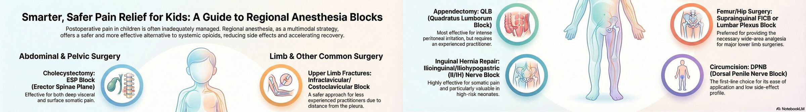

Çocuklarda en sık yapılan ameliyatlar; ekstremite kırıkları, apendektomi, inguinal herni, sünnet, piloromiyotomi ve kolesistektomi. Bu girişimlerde postoperatif ağrı hâlâ yetersiz tedavi ediliyor ve kontrolsüz ağrı anksiyete, uyku bozukluğu ve davranış değişikliği gibi uzun süreli sonuçlar bırakabiliyor [6, 8]. Rejyonal anestezi opioid gereksinimini azaltarak multimodal analjezinin güvenli bir bileşeni oluyor [11, 12]. Bu rehber, her cerrahi için hangi bloğu neden seçebileceğinizi ve nelere dikkat etmeniz gerektiğini özetliyor.

## Hızlı seçim tablosu

| Cerrahi | Bloklar ve doz (%0,25 bupivakain, aksi belirtilmedikçe) | Ne zaman hangisi? |
|---|---|---|
| **Apendektomi** | ESP 0,3–0,5 mL/kg QLB 0,2–0,4 mL/kg TAP 0,3–0,5 mL/kg Kaudal 0,5 mL/kg | Viseral + somatik ağrı için ESP ya da QLB; yalnız somatik için TAP; orta hat kesisi varsa bilateral TAP. |
| **İnguinal herni** | Kaudal 0,5 mL/kg İİ/İH 0,3 mL/kg (%0,5) TAP 0,3–0,4 mL/kg QLB 0,3–0,5 mL/kg ESP 0,3–0,5 mL/kg | Kaudal daha geniş alan sağlar ama motor blok riski taşır; kaudal uygun değilse İİ/İH ya da TAP (az LA, düşük motor blok riski). |
| **Sünnet** | DPNB 0,1 mL/kg Kaudal 0,5 mL/kg Halka blok (infiltrasyon) | Günübirlik cerrahi ve kolay uygulama için DPNB ya da halka blok. |
| **Piloromiyotomi** | Rektus kılıf 0,2 mL/kg TAP 0,3–0,5 mL/kg | Somatik ağrı ve orta hat insizyonu için. |
| **Kolesistektomi** | ESP (bilateral\*) 0,3–0,5 mL/kg TAP 0,2–0,3 mL/kg | ESP birden çok dermatoma ve paravertebral alana yayılır; TAP somatik ağrı için kolay bir bileşen. |
| **Üst ekstremite kırığı** | Supraklaviküler 0,15–0,2 mL/kg (%0,25–0,5) İnfraklaviküler / kostoklaviküler 0,5 mL/kg (%0,25–0,5) | İnfra- ve supraklaviküler yaygın ve etkili analjezi sağlar; kostoklaviküler daha hızlı yapılır. |
| **Alt ekstremite kırığı** | Femoral 0,2–0,5 mL/kg Fasya iliaka 0,5 mL/kg Lomber pleksus 0,2–0,5 mL/kg | Femoral blok daha uzun sürer; fasya iliakada obturator tutulmayabilir; lomber pleksus tek taraflı ve uzun etkili. |

*Dozlar 6 aydan büyük çocuklar içindir. 6 aydan küçüklerde hem dozu hem konsantrasyonu azaltın. \*Bilateral uygulamada sistemik toksisite riski nedeniyle konsantrasyonu düşürmeyi düşünün.*

> [!DIKKAT]
> Çocuklar, özellikle yenidoğan ve infantlar, azalmış metabolik kapasite ve düşük protein bağlanması nedeniyle lokal anesteziklere daha duyarlıdır. LA türünü, konsantrasyonunu ve toplam dozu yaşa göre bireysel hesaplayın [51, 79].

## Ekstremite kırıkları

**Ağrı:** Ortopedik cerrahi çocuklarda sıklıkla şiddetli ağrıya ve parenteral opioide yol açar; ağrı ilk 48 saatte en yüksektir [16, 19]. Suprakondiler humerus kırığında ağrı ameliyat sonrası sabah zirve yapar ve ancak 3. günde belirgin olarak azalır [21].

**Üst ekstremite: brakiyal pleksus blokları**
- **Supraklaviküler:** Uzun süreli analjezi sağlar; ancak plevraya yakınlık nedeniyle deneyim gerektirir [23].
- **İnfraklaviküler:** Acil serviste önkol kırığının kapalı redüksiyonunda sedoanaljeziden daha düşük ağrı skoru ve daha yüksek ebeveyn memnuniyeti sağlar [24].
- **Kostoklaviküler:** Lateral sagittal yaklaşımla benzer analjezi, daha kısa uygulama süresi [26, 27]. Pleksusun kompakt görüldüğü bölgede yapıldığı için çocuklarda pratik ve güvenli bir seçenek.

**Alt ekstremite**
- **Femoral sinir bloğu:** Femur kırığında analjezi süresini uzatır, analjezik gereksinimini azaltır [29].
- **Fasya iliaka bloğu:** Ağrı skorlarını ve sistemik analjezik dozunu düşürür [30].
- **Lomber pleksus bloğu:** Kalça cerrahisinde kaudal blokla benzer opioid tüketimi; ama tek taraflı etki, daha uzun analjezi ve daha düşük idrar retansiyonu riski. Derin bir blok olduğu için deneyim ister [31, 32].

> [!DIKKAT]
> İnfrainguinal fasya iliaka bloğunda yayılım femoral sinirle sınırlı kalabilir; obturator bölgesinde analjezi yetersiz olur. Büyük kemik cerrahisinde tek başına femoral blok yetmeyebilir. Suprainguinal fasya iliaka, lomber pleksus ya da blok kombinasyonlarını düşünün.

> [!IPUCU]
> Tek doz blokların etkisi geç saatlerde biter. Uzun süren ağrı beklenen ortopedik girişimlerde **kateterle sürekli teknik** planlayın.

## Kolesistektomi

**Ağrı:** Somatik + viseral + omuz ağrısı (yansıyan ağrı). Kontrol edilmezse yatış uzar, mobilizasyon gecikir. Ketorolak tabanlı opioidsiz protokoller ve ERAS uygulamaları opioid tüketimini ve yatış süresini azaltıyor [35, 36].

**Seçenekler**
- **ESP bloğu:** Bilateral L1 düzeyinde kontrol grubuna göre daha düşük ağrı skoru ve ek analjezik gereksinimi [38]. En az 5 dermatoma yayılır [40]. Olgu raporlarında T7 ya da T9 düzeyinden uygulanmış; çocuklarda ideal düzey belirsiz [41–43].
- **Paravertebral blok:** İntraoperatif opioid kullanımını azaltır [37]; ESP daha kolay ve görece daha güvenlidir.
- **TAP / OSTAP:** Standart TAP yara infiltrasyonundan üstün bulunmadı [44]; oblik subkostal TAP somatik ağrıda etkili [45].

> [!IPUCU]
> Çocuklarda FPB yayılımına ilişkin veri az. Teknik seçiminde kendi deneyiminiz ve klinik olanaklarınız belirleyici olsun.

## Piloromiyotomi

**Ağrı:** Hafif-orta; trokar yerleri ve karın duvarının gerilmesine bağlı somatik, pnömoperitona bağlı viseral bileşen. 11.008 infantın %26'sında opioid gerekti ve bu durum maliyeti %13'e kadar artırdı [47].

**Seçenekler**
- **Rektus kılıf bloğu:** İnfiltrasyonla benzer analjezi, ama **daha az lokal anestezikle** [50]. Yenidoğanda bu fark önemlidir.
- **OSTAP:** Düşük FLACC skoru ve opioid gereksinimi; TAP'tan farklı olarak viseral analjezi de sağlayabilir [48, 49].
- **QLB:** Viseral ağrıyı da kapsar; ama derin ve teknik olarak zor, deneyim ister [52].

> [!DIKKAT]
> Yenidoğanda hepatik metabolizma immatür, protein bağlama kapasitesi düşük, vasküler emilim fazladır. LAST riski yüksektir; dozu titre edin [51].

## Apendektomi

**Ağrı:** Peritoneal irritasyon + viseral + somatik; ilk 24 saatte ortalama VAS 4–5 [53].

**Seçenekler**
- **TAP:** Tek taraflı TAP 48 saatlik opioid tüketimini yaklaşık yarıya indirir (10,3 mg'a karşı 22,3 mg) [54]. Kaudal blokla benzer etkinlik, daha az ek analjezik [55]. Ancak bilateral TAP port yeri infiltrasyonuna üstün bulunmadı [56].
- **ESP:** Alt karın cerrahisinde kaudala göre daha düşük FLACC ve daha uzun analjezi [57].
- **QLB:** Psoas ve torakolomber fasya aracılığıyla derin yayılım; T10–L4 analjezisi, özellikle peritoneal ağrıda üstün [58]. Laparoskopik apendektomide TAP'tan daha düşük ağrı ve opioid kullanımı [61].

> [!YAPMAYIN]
> Orta hatta çok sayıda trokar kullanılan laparoskopik apendektomide yalnızca TAP'a güvenmeyin. TAP viseral ağrıyı kontrol etmez; ESP ya da QLB daha uygun.

## İnguinal herni

**Ağrı:** İnsizyonel ve somatik, viseral bileşen de var. Çocukların %3'ü herni onarımına ihtiyaç duyar [63].

**Seçenekler**
- **Kaudal blok:** Klasik ve yüksek başarılı; ama bilateral etki, motor blok ve mesane disfonksiyonu riski [65].
- **İlioinguinal/iliohipogastrik:** Daha az LA, düşük motor blok riski, erken mobilizasyon; prematüre yenidoğanda bile güvenli [66–68]. Anatomik varyasyonlar nedeniyle deneyim ister.
- **TAP:** İİ/İH sinirleri de bu planda seyreder; doğru teknikle İİ/İH bloğuna alternatif [69].
- **QLB:** İlk 24 saatte daha az analjezik ve daha düşük ağrı skoru [70].
- **ESP:** 120 çocukta kaudala göre daha iyi postoperatif analjezi ve daha az kurtarma analjezisi [71]. Daha periferik olduğu için kaudalın komplikasyonlarından kaçınılır.

> [!IPUCU]
> Blok kombinasyonları ya da adjuvanlar etkinliği artırabilir [72]. Erişkinlerde herni sonrası kronik ağrı %10–14; çocuklarda veri yok ama yetersiz analjezi bu riski artırabilir [73].

## Sünnet

**Ağrı:** Kısa ve minimal invaziv bir girişim olmasına karşın şiddetli huzursuzluk, uyku bozukluğu ve oral alımda gecikme yapabilir. Ağrı çocuklarda anksiyeteyi ve davranış değişikliğini belirgin olarak artırır [75].

**DPNB ya da kaudal?**
- Kurtarma analjezisi gereksinimi benzer; **motor güçsüzlük ve bacak zayıflığı kaudalda daha sık** [76].
- Kaudal ilk 1–3 saatte daha düşük ağrı skoru sağlayabilir, ama 2. günde fark yok [77].
- DPNB daha kolay uygulanır, komplikasyonu daha azdır [78].

> [!YAPIN]
> Günübirlik sünnette ilk tercih olarak **DPNB** (0,1 mL/kg %0,25 bupivakain) ya da **halka blok** kullanın.

## Akılda kalması gerekenler

- [ ] Blok seçimini cerrahiye, ağrının karakterine (somatik / viseral) ve kendi deneyiminize göre yapın.
- [ ] Viseral ağrı bekleniyorsa TAP'la yetinmeyin; ESP ya da QLB düşünün.
- [ ] Dozu kg'a göre hesaplayın; 6 aydan küçükte doz ve konsantrasyonu azaltın.
- [ ] Bilateral bloklarda konsantrasyonu düşürün.
- [ ] Uzun süren ağrı bekleniyorsa kateter planlayın.
- [ ] Her bloğu ultrasonografi eşliğinde yapın ve yayılımı görün.

